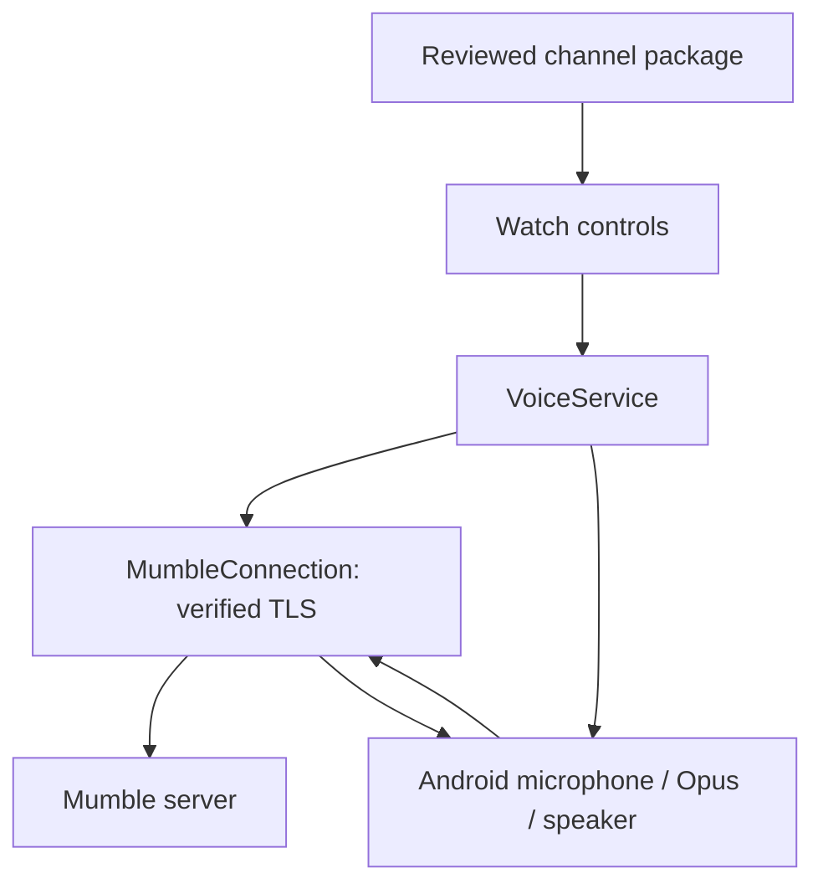

# Standalone architecture

## Runtime

The APK has its own package, `se.takcampus.voice.standalone`, launcher and private foreground
service. It has no dependency on the WearTAK SDK or its signature permission.

`MumbleConnection` implements bounded control framing, protobuf fields, login, synchronized
channel state and legacy Opus datagrams over Mumble's TCP tunnel. It advertises Mumble 1.3
wire compatibility and Opus capability. UDP, whisper targets, channel linking and automatic
reconnect are not implemented.

PTT is permitted only after a live channel join is confirmed and the server has not muted,
deafened or suppressed the user. Imported IDs must still name the expected channel. A capture
token is invalidated on release; stale queued audio is discarded and an end-of-transmission
packet is sent. Transmissions never resume automatically after reconnect or route changes.

`VoiceAudio` uses platform MediaCodec Opus at 48 kHz mono, AudioRecord only during PTT and
AudioTrack for playback. Receive work is bounded to 24 queued packets and four active decoders;
stale audio is dropped rather than replayed late. Device behaviour and audio quality still need
physical-watch testing. The foreground service owns session lifetime and notification controls.

## Authentication and storage

The SSL context uses system trust or explicitly imported private CA certificates and always
checks the server hostname. An optional imported PKCS#12 identity supplies client key managers.
A Mumble password is optional when the server accepts that certificate identity. No trust-all
mode, host-credential extraction or plaintext Mumble transport is provided.

Settings and imported identity material are encrypted in an atomic private file with AES-GCM
using an Android Keystore key. The key is non-exported; decrypted credentials/private-key data
still exist in the app process when needed for TLS. Backup is disabled. This does not make a
compromised running app unable to use its credentials.

The server remains responsible for trusting the certificate, identifying the user, revocation
and channel ACLs. A presented common name or matching TAK callsign alone is not authentication.
No TAKS authenticator was changed or deployed by this client milestone.

## Channel onboarding

TAKS emits a mission ZIP with `MANIFEST/manifest.xml`, extensionless JSON and `_proto` data.
The importer supports both verified TAKS binary server-record layouts, including binary-only
packages; matching JSON and binary contents are required when both are present. Arbitrary
Vx/Vx2 binary schema compatibility is not claimed.

`ChannelStore` retains pending and accepted configuration plus 64 transfer receipts in one
atomic file. SHA-256 binds a transfer to its bytes; it does not authenticate a sender. In this
standalone version, `VoiceHandoff` is internal staging data, not an exported broadcast API.
The signature-protected receiver and plugin Binder service from 0.1 have been removed.

A wearer selects a ZIP through a document provider or the app-owned ADB import folder,
reviews it, and accepts it. Configuration import does not connect, grant channel access,
install trust or transfer passwords. Automatic Companion, Martine and acoustic delivery are
future work and must define their own authorized import/enrollment boundary.

## Sound provisioning and input

`AudioLinkCodec` is a bounded pure-Java acoustic HTTPS-link transport. `AudioOnboarding`
records only during the visible setup flow, validates the link, confirms its origin, and
POSTs its single-use ticket over standard verified HTTPS without redirects. Profile validation
requires the voice host to match the heard origin. Accepted settings, assigned default channel
and expiry are sealed in one settings-vault write. Existing configuration is not changed by
listening, a failed download, or a rejected review. The saved channel is attempted once after
login and requires server acknowledgement before PTT is enabled.

`PttButton` handles momentary state, fresh presses and repeats. Android input handles only a
learned delivered key. Activity focus/lifecycle changes clear its state and release PTT.
The protocol details and limitations are in [sound onboarding](AUDIO_ONBOARDING.md).
