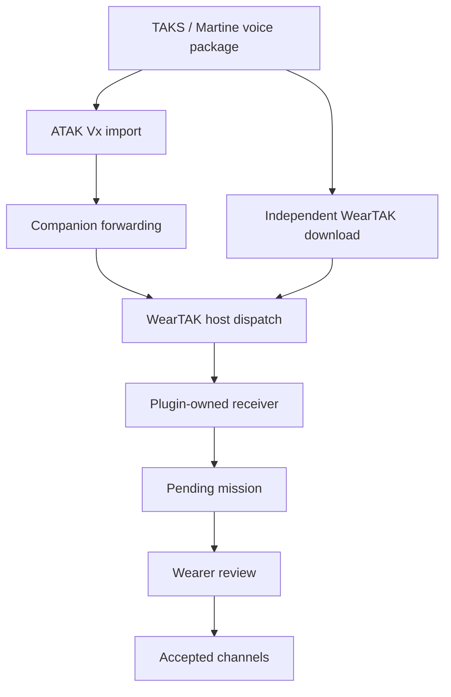

# Architecture and contracts

## Configuration flow

Plugin import, staging and review are implemented. Companion forwarding and independent
host dispatch are prepared as separate source patches and remain unverified integrations.
The native ZIP file picker provides a direct import path for prototype testing.

## Package formats

TAKS emits `MANIFEST/manifest.xml`, extensionless mission JSON and a `_proto` entry.
TAKCTL wraps the protobuf server record in field 1; Martine writes that record directly.
The importer handles both verified encodings and checks JSON/binary agreement. It is not
claimed to decode every Vx/Vx2 version or arbitrary third-party binary schema.

Channel IDs come from the package and are never synthesized by this importer. Before live
transmit is implemented, the client must verify the live ID still names the intended channel;
server recreation must not silently redirect transmission.

The legacy JSON `missionDefaultProtocol: UDP` is mission metadata. It does not authorize
plaintext transport or disabling TLS for the future Mumble connection.

## Plugin receiver

- Package: `se.takcampus.voice.watch`
- Action: `se.takcampus.voice.STAGE_CHANNELS`
- Required sender permission: `com.weartak.plugin.permission.BIND_PLUGIN` (signature)
- Intent extra: `envelope`, a UTF-8 JSON string bounded to 49,152 bytes
- Message type: `voice_channels_v1`; version: integer `1`
- Fields: `type`, `version`, `transferId`, `sha256`, `missionJson`

`missionJson` is a string containing the exact validated mission JSON. SHA-256 binds the
receipt to those bytes. It does not authenticate the sender; authentication comes from
the signature permission and, on the proposed delivery paths, the bonded phone link or
authenticated TAK download.

The importer bounds compressed/expanded sizes, entry count, JSON/protobuf payloads and
nesting. It rejects unsafe ZIP paths, ambiguous missions, unsupported channel types and
unexpected configuration fields. Credentials and certificate trust are outside this contract.

## Receipt semantics

| Status | Meaning |
| --- | --- |
| `STAGED` | Pending configuration was written durably; wearer review is required |
| `APPLIED` | The wearer accepted and saved that configuration |
| `REJECTED` | The wearer dismissed it |
| `UNAVAILABLE` | Host could not obtain a valid receiver acknowledgement |

The first three are receiver states. `UNAVAILABLE` is a proposed host transport result,
including missing plugin, incompatible signing, timeout or failed staging.
No receipt means authenticated to Mumble, joined a channel, or able to transmit audio.

An atomic file contains pending state, accepted state and the last 64 transfer receipts.
Repeating a retained transfer ID with identical bytes is idempotent; changing its digest is
rejected. Another mission cannot replace an unreviewed pending mission. The bounded ledger
is not an unlimited replay database, and packages have no signed revision/expiry yet.

## Audio design constraints

The plugin will own the Mumble session, channel control, Opus engine, playback and PTT state.
Host v3 PCM capture and independent capture require negotiated ownership and bounded queues.
A paired watch needs either a usable OS network route or a separately implemented phone audio
relay; the existing Companion JSON link alone supplies neither.

Release PTT on cancel, disconnect, route change, permission loss and shutdown. Discard stale
queued audio; do not replay it after reconnect or automatically resume a held transmission.
Server TLS verification, user authentication and channel ACLs are distinct checks.

## Credentials and trust

Current TAKS voice packages do not contain the Mumble password. Future authentication and
trust provisioning must remain explicit and must not leak secrets through settings schemas,
action arguments, receipts, fixtures or logs. A watch and phone need distinct device sessions
mapped to the same operator, rather than accidentally competing for one Mumble identity.
